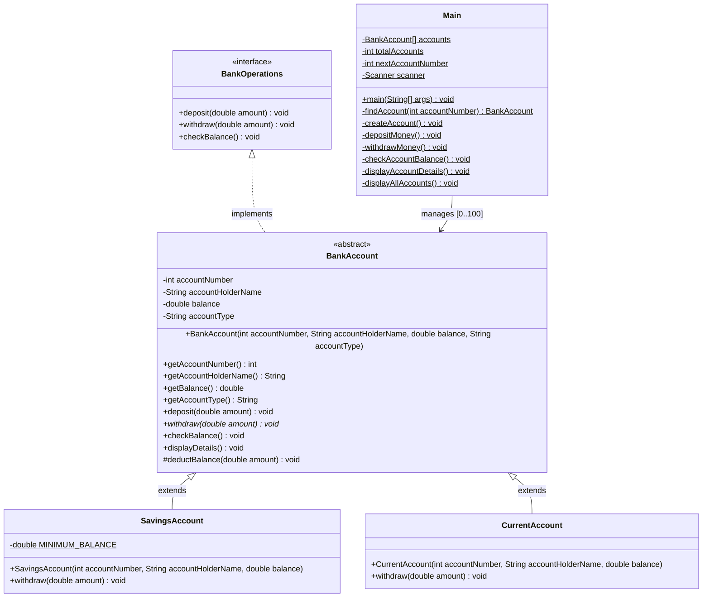

# 🏦 Bank Management System

A robust, console-based **Bank Management System** developed in Java. This application demonstrates the fundamental pillars of **Object-Oriented Programming (OOP)**, modular software design, defensive programming, and in-memory data management without relying on external libraries or databases.

---

## 📋 Table of Contents

- [Problem Statement](#-problem-statement)
- [Key Features](#-key-features)
- [Concepts Involved (OOP & Java)](#-concepts-involved-oop--java)
- [UML Diagrams](#-uml-diagrams)
- [Project Structure](#-project-structure)
- [Account Types & Business Rules](#-account-types--business-rules)
- [How to Run the Application](#-how-to-run-the-application)
  - [Prerequisites](#prerequisites)
  - [Compilation & Execution](#compilation--execution)
- [Sample Execution & Walkthrough](#️-sample-execution--walkthrough)

---

## 📌 Problem Statement

Traditional manual banking record-keeping and loosely structured software systems present several critical challenges:
1. **Data Inconsistency & Tampering:** Lack of data protection allows direct, unauthorized modification of sensitive attributes such as account balances and account identifiers.
2. **Lack of Standardized Operations:** Different account categories (e.g., Savings vs. Current) require distinct transaction logic (such as minimum balance limits), but without a unified interface, code duplication and runtime inconsistencies arise.
3. **Rigid Code Architecture:** Without abstraction and polymorphism, introducing new account types or modifying business policies requires modifying core transaction handlers across the entire codebase.
4. **Vulnerability to Invalid Input:** Console applications frequently crash or produce corrupted states when unexpected data types (strings instead of numbers, negative deposit amounts, or invalid choices) are entered.

### Solution
This project resolves these issues by delivering a modular, contract-driven banking solution:
- Enforces strict data encapsulation with private fields and controlled accessor/mutator methods.
- Employs an interface-and-abstract-class hierarchy defining standardized operations while delegating account-specific rules to concrete subclasses.
- Implements dynamic polymorphism to execute tailored withdrawal rules seamlessly at runtime.
- Employs robust scanner input sanitization and defensive validation checks to prevent runtime crashes and ensure data consistency.

---

## ✨ Key Features

- **Account Creation:**
  - Support for multiple account categories: **Savings Account** and **Current Account**.
  - Automated, sequential account number generation (starting from `1001`).
  - Validation of initial deposit thresholds.
- **Deposit Operations:**
  - Real-time balance updating with validation against zero and negative amounts.
- **Withdrawal Operations:**
  - Polymorphic rule execution:
    - **Savings Account:** Enforces a mandatory minimum balance of ₹500.00.
    - **Current Account:** Permits withdrawals up to the available balance with zero minimum balance requirement.
  - Clear, user-friendly error messages when funds are insufficient.
- **Account Inquiries & Reporting:**
  - Single account balance check.
  - Comprehensive account metadata display (Account Number, Holder Name, Account Type, Balance).
  - Directory listing displaying all registered bank accounts.
- **Defensive Console Input Handling:**
  - Guards against invalid inputs (e.g., character inputs when integers/doubles are expected) and flushes the scanner buffer to avoid infinite loops.

---

## 🧠 Concepts Involved (OOP & Java)

The project serves as an exemplar of the core principles of **Object-Oriented Programming (OOP)** and Java idioms:

1. Interface: BankOperations.java
2. Abstract: BankAccount.java
3. Child classes: SavingsAccount.java, CurrentAccount.java
4. Main class: Main.java
---

## 📊 UML Diagrams

The following Mermaid class diagram visualizes the relationships, access modifiers, field types, and method signatures across the system:



---


## 📁 Project Structure

```text
Bank Management/
│
├── BankOperations.java    # Interface defining standard banking method contracts
├── BankAccount.java       # Abstract base class implementing common logic & encapsulation
├── SavingsAccount.java    # Concrete class with ₹500 minimum balance constraint
├── CurrentAccount.java    # Concrete class with flexible zero-minimum withdrawal rule
├── Main.java              # Entry point: interactive console CLI, memory storage, validation
└── README.md              # Project documentation, architecture analysis, and execution guide
```

---

## 💼 Account Types & Business Rules

| Account Type | Minimum Initial Deposit | Minimum Ongoing Balance | Withdrawal Rules |
| :--- | :--- | :--- | :--- |
| **Savings Account** | `₹500.00` | `₹500.00` | Permitted only if the remaining balance after deduction is at least `₹500.00`. |
| **Current Account** | `₹0.00` (non-negative) | `₹0.00` | Permitted up to the full available balance; no minimum reserve required. |

---

## 🚀 How to Run the Application

### Prerequisites

- **Java Development Kit (JDK):** Version 8 or higher (JDK 11, 17, or 21 LTS recommended).
- Verify your Java installation by running:
  ```bash
  javac -version
  java -version
  ```

---

### Compilation & Execution

#### Step 1: Open Terminal / Command Prompt
Navigate to the root directory where the source code files are located:

```bash
cd src
```

#### Step 2: Compile All Java Source Files
Compile all the `.java` files simultaneously:

```bash
javac *.java
```
*Note: This generates the `.class` bytecode files (`BankOperations.class`, `BankAccount.class`, `SavingsAccount.class`, `CurrentAccount.class`, `Main.class`).*

#### Step 3: Launch the Application
Run the `Main` class using the Java virtual machine:

```bash
java Main
```

---

## 🖥️ Sample Execution & Walkthrough

Here is an example walkthrough of the console session:

### 1. Creating a Savings Account
```text
===== BANK MANAGEMENT SYSTEM =====
1. Create Account
2. Deposit Money
3. Withdraw Money
4. Check Balance
5. Display Account Details
6. Display All Accounts
7. Exit
Enter your choice: 1

--- Create New Account ---
Select Account Type:
1. Savings Account (Requires minimum balance of ₹500.00)
2. Current Account (No minimum balance requirement)
Enter account type choice (1 or 2): 1
Enter Account Holder Name: Ebon
Enter Initial Deposit Amount: ₹1500.00

Success: Savings Account created successfully!
Assigned Account Number: 1001
```

### 2. Depositing Funds
```text
===== BANK MANAGEMENT SYSTEM =====
...
Enter your choice: 2

--- Deposit Money ---
Enter Account Number: 1001
Enter Amount to Deposit: ₹500.00
Success: ₹500.00 deposited successfully.
Updated Balance: ₹2000.00
```

### 3. Attempting Withdrawal Below Minimum Balance (Validation)
```text
===== BANK MANAGEMENT SYSTEM =====
...
Enter your choice: 3

--- Withdraw Money ---
Enter Account Number: 1001
Enter Amount to Withdraw: ₹1600.00
Error: Cannot withdraw ₹1600.00.
Savings account must maintain a minimum balance of ₹500.00.
Maximum amount you can withdraw right now: ₹1500.00
```

### 4. Successful Withdrawal
```text
===== BANK MANAGEMENT SYSTEM =====
...
Enter your choice: 3

--- Withdraw Money ---
Enter Account Number: 1001
Enter Amount to Withdraw: ₹1000.00
Success: ₹1000.00 withdrawn successfully.
Remaining Balance: ₹1000.00
```

### 5. Displaying Account Details
```text
===== BANK MANAGEMENT SYSTEM =====
...
Enter your choice: 5

--- Account Details ---
Enter Account Number: 1001
----------------------------------------
Account Number : 1001
Account Holder : Ebon
Account Type   : Savings Account
Balance        : ₹1000.00
----------------------------------------
```

